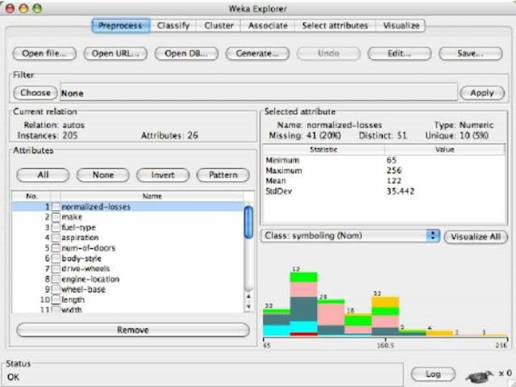
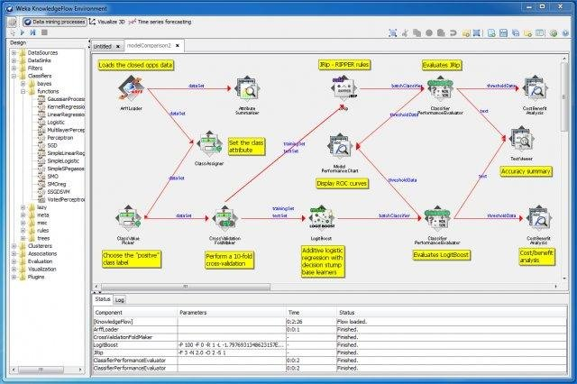

# Weka Links Dataset Structure With Model Evaluation

A useful weka ml experiment starts with a clearly defined target and an evaluation plan.
Use the Explorer interface to inspect data, then reproduce selected experiments through the weka java API or command line.

[](https://weka-ml.github.io/Weka-Java/)

## Describe the observations before fitting a model

A weka machine learning dataset needs explicit attribute types and a consistent meaning for each row.
Distinguish measurements, categories, identifiers, and the value you want to predict.
Remove information that would only become available after the predicted event.

This small ARFF example illustrates a nominal target in the final column:

```arff
@relation visit_outcomes
@attribute visits numeric
@attribute channel {web,store}
@attribute converted {no,yes}

@data
1,web,no
4,store,yes
2,web,no
5,store,yes
```

The [ARFF documentation](https://waikato.github.io/weka-wiki/formats_and_processing/arff/) explains the relation, attribute declarations, and data section.
These four invented rows demonstrate syntax; they are not evidence of a useful predictive relationship.
In a real dataset, inspect missing values, class counts, duplicates, and the provenance of each field.



## Choose the task from the target representation

In weka software, the same table of observations can support different analytical questions.
Choose the task before choosing a learner or interpreting its output.

| Analytical question | Target representation | Example Weka method |
| --- | --- | --- |
| Which category applies? | One nominal class attribute | J48 |
| What numeric value is expected? | One numeric class attribute | M5P |
| Which observations form groups? | No prediction target supplied to the clusterer | SimpleKMeans |
| Which item patterns occur together? | Attributes representing observed items or values | Apriori |

A category encoded as an integer is still a category if its numbers are identifiers rather than measurements.
An identifier that uniquely names a row is rarely a useful predictor by itself.
For clustered data, assess the grouping against the intended use instead of reporting classification accuracy.

## Establish a baseline and preserve the evaluation boundary

A weka data mining comparison needs a reference result and the same evaluation conditions for each learner.
ZeroR provides a simple baseline; J48 offers a decision-tree comparison for a nominal target.

With an existing Weka JAR and independently prepared training and test datasets, compare the two:

```bash
java -cp weka.jar weka.classifiers.rules.ZeroR -t training.arff -T heldout.arff -c last -i
java -cp weka.jar weka.classifiers.trees.J48 -t training.arff -T heldout.arff -c last -i
```

Both files must have compatible attribute declarations and ordering.
The [Evaluation reference](https://weka.sourceforge.io/doc.stable/weka/classifiers/Evaluation.html) documents the training, test, class-index, and reporting options.
Read the test-set evaluation separately from the statistics calculated on training data.
Keep the held-out dataset for final assessment after model choices have been settled.

- Record the data split and the learner options with the reported result.
- Keep observations from the same person or device together when that dependency matters.
- Use time-aware evaluation when later observations depend on earlier ones.
- Fit learned preprocessing inside the training portion of each evaluation split.

## Run cross-validation through the Java API

For an ordinary independent-observation classification dataset, cross-validation can estimate performance during model development.
This example uses five folds and a fixed random seed on the training data.
Place the statements inside a Java method that handles or declares Exception, with Weka on the classpath.

```java
weka.core.Instances data =
    weka.core.converters.ConverterUtils.DataSource.read("training.arff");
data.setClassIndex(data.numAttributes() - 1);
weka.classifiers.Evaluation cv = new weka.classifiers.Evaluation(data);
cv.crossValidateModel(new weka.classifiers.trees.J48(), data, 5,
    new java.util.Random(23));
System.out.println(cv.toSummaryString());
System.out.println(cv.toMatrixString());
```

Use a dataset large enough for the chosen fold count and inspect the representation of each class.
The [Java API guide](https://waikato.github.io/weka-wiki/use_weka_in_your_java_code/) explains that cross-validation trains copies of the supplied classifier.
Passing an untrained J48 leaves fold-specific training to the evaluation routine.
This example does not implement grouped, temporal, or nested cross-validation.

## Compare the supplied data fixtures by output shape

The Tribuo fixtures illustrate why the interpretation of output columns matters.

| Fixture | Output shape illustrated |
| --- | --- |
| [multioutput-regression.csv](tests/src/test/resources/org/tribuo/tests/csv/multioutput-regression.csv) | Two numeric responses with a header |
| [multioutput-regression-noheader.csv](tests/src/test/resources/org/tribuo/tests/csv/multioutput-regression-noheader.csv) | The corresponding rows without a header |
| [multilabel.csv](tests/src/test/resources/org/tribuo/tests/csv/multilabel.csv) | Multiple Boolean label columns |

Tribuo checks the loading behavior in [CSVLoaderWithMultiOutputsTest.java](tests/src/test/java/org/tribuo/tests/csv/CSVLoaderWithMultiOutputsTest.java).
[CSVSaverWithMultiOutputsTest.java](tests/src/test/java/org/tribuo/tests/csv/CSVSaverWithMultiOutputsTest.java) covers saving multi-output data.
These response layouts require explicit modeling choices before being represented as a standard single-class Weka experiment.

JSON fixtures include [test.json](Json/src/test/resources/org/tribuo/json/test.json) and the empty-array case [empty.json](Json/src/test/resources/org/tribuo/json/empty.json).
[JsonDataSourceTest.java](Json/src/test/java/org/tribuo/json/JsonDataSourceTest.java) exercises Tribuo's JSON data-source behavior.
The JSON format here belongs to those tests and is not a Weka ARFF schema.

## Read errors before celebrating an aggregate score

Overall accuracy can hide poor performance on a rare class.
Inspect the confusion matrix and the per-class precision and recall alongside the summary.
For regression, interpret error magnitudes in the units and scale of the target.

Compare errors with the practical purpose of the model.
A missed positive and an unnecessary alert may have different consequences.
Report the evaluation protocol with the score so another reader can judge what the result supports.



## Trace the supplied Java support files

Tribuo's JSON package is described in [package-info.java](Json/src/main/java/org/tribuo/json/package-info.java).
[JsonDataSource.java](Json/src/main/java/org/tribuo/json/JsonDataSource.java) implements its JSON-backed data source.
[JsonFileIterator.java](Json/src/main/java/org/tribuo/json/JsonFileIterator.java) converts JSON records into columnar rows.
[JsonUtil.java](Json/src/main/java/org/tribuo/json/JsonUtil.java) contains JSON utilities.
[StripProvenance.java](Json/src/main/java/org/tribuo/json/StripProvenance.java) provides provenance-removal tooling for Tribuo models.

[Resources.java](tests/src/main/java/org/tribuo/tests/Resources.java) supports access to test resources.
[EnsembleExportTest.java](tests/src/test/java/org/tribuo/tests/onnx/EnsembleExportTest.java) tests Tribuo ensemble export to ONNX.
The parent Maven configuration is [pom.xml](pom.xml).
The JSON module configuration is [pom.xml](Json/pom.xml), and the test module configuration is [pom.xml](tests/pom.xml).
The aggregate distribution configuration is [pom.xml](distribution/pom.xml).
[LICENSE.txt](LICENSE.txt) contains the Apache License 2.0 text supplied with this snapshot.

The uploaded files form a partial Tribuo snapshot; Weka application sources and the example Weka JAR and datasets are absent.
These supporting files belong to a separate Java ML library and do not define Weka APIs or build requirements.
For Weka's own code and development information, use the [official source documentation](https://waikato.github.io/weka-wiki/development/).

## Related Search Terms

weka ml, weka java, weka machine learning, weka software, weka data mining, machine-learning, java, classification, regression, clustering, data-mining, cross-validation, arff, data-preprocessing, visualization
